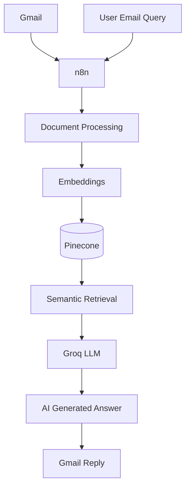

# Gmail AI Automation

An AI-powered Gmail automation system built using **n8n, Pinecone, Groq, and RAG (Retrieval-Augmented Generation)** to process documents, retrieve relevant information, and automatically answer email queries.

## Features

- Automated document processing through Gmail.
- Text extraction and chunking.
- Vector embeddings generation.
- Semantic search using Pinecone.
- Context-aware responses using Groq (Llama 3.3 70B).
- Automated email replies through Gmail.
- Two interconnected n8n workflows.

## Tech Stack

- **Automation:** n8n
- **LLM:** Groq (Llama 3.3 70B)
- **Vector Database:** Pinecone
- **Embeddings:** Embedding Model / Provider
- **Email Integration:** Gmail
- **Architecture:** Retrieval-Augmented Generation (RAG)

## Workflow

**1. Document Ingestion**
- Receive documents through Gmail.
- Extract and chunk text.
- Generate embeddings.
- Store vectors in Pinecone.

**2. Email Question Answering**
- Receive user questions through Gmail.
- Generate question embeddings.
- Retrieve relevant information from Pinecone.
- Generate answers using Groq.
- Automatically send responses through Gmail.

## Architecture

## Setup

1. Clone this repository.
2. Import the n8n workflow JSON files.
3. Configure Gmail credentials.
4. Add Pinecone API credentials and configure your index.
5. Configure Groq API credentials.
6. Connect your embedding provider.
7. Activate and test both workflows.

## Future Improvements

- Multi-document support.
- Conversation memory.
- Source citations.
- Improved error handling and response validation.

## Author

**Hassam** | Data Scientist & AI Engineer

- [GitHub](https://github.com/Rajpoot-10)
- [Portfolio](https://hassam-ali-self.vercel.app/)
